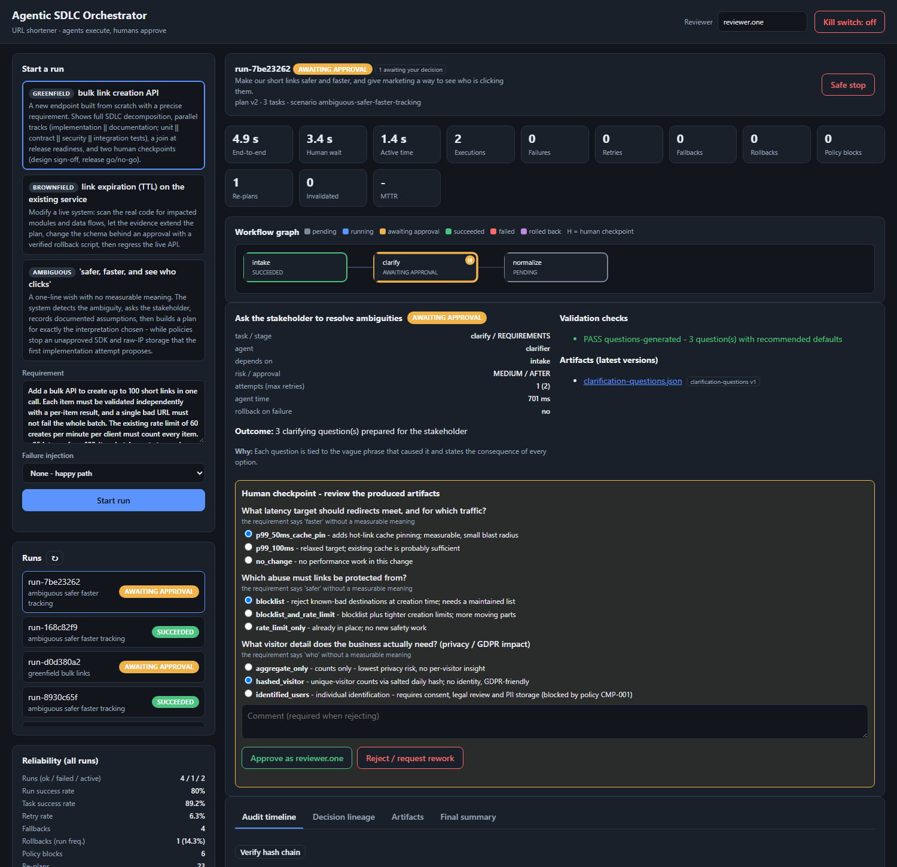

# Agentic SDLC Orchestrator - URL Shortener

A URL shortener (Java 21 / Spring Boot / PostgreSQL / Redis) **plus a governed agentic orchestration layer** that turns a
requirement into a reviewable engineering outcome: requirement analysis, design, implementation, tests, documentation and
release readiness - executed by agents under explicit autonomy boundaries, with humans owning approvals and final quality.

> **Agents execute. Humans approve. Policies cannot be waived by agents.**
> Nothing in this prototype deploys anything: the release step assembles a hash-pinned *dry-run* bundle.



## What is in the box

| Part | What it is |
|---|---|
| **Shortener service** | `POST/GET/DELETE /api/v1/links`, `GET /{code}` (302), `GET /api/v1/links/{code}/stats`. Collision-free codes, Redis cache-aside with negative caching, fixed-window rate limit, URL safety validation, async click analytics with privacy-preserving visitor hashes, RFC 7807 errors, Flyway, Micrometer/Prometheus. |
| **Orchestrator** | Stateful DAG engine: entry/exit gates, parallel branches + joins, human approval checkpoints, bounded retries, fallback agents, rollback, safe-stop + global kill switch, dynamic re-planning, hash-chained audit log, decision lineage, reliability metrics (success rate, retry/rollback rate, MTTR, latency). |
| **Policies** | Secret scan, no-raw-PII, dependency allow-list, unsafe-code, workspace boundary, change control (approval + rollback script). Code, not prompts - agents cannot waive them. |
| **14 agents** | Requirements analyst, clarifier, architect, codebase analyst, migration author/validator, codegen (+ conservative fallback), unit-test runner, contract tester, smoke tester, security reviewer, doc writer, release manager/packager. Deterministic and offline; an LLM-backed agent implements the same `Agent` contract. |
| **Dashboard** | `http://localhost:8080/` - live DAG, approvals, answers to clarification questions, audit timeline with hash-chain verification, decision lineage, artifacts, auto-generated final summary. |
| **3 scenarios** | Greenfield (bulk API), Brownfield (link expiry on the real code), Ambiguous ("safer, faster, see who clicks") - see [docs/SCENARIOS.md](docs/SCENARIOS.md). |

## Quick start (Docker only - no local Java needed)

```bash
docker compose up -d --build          # postgres + redis + app
# open the dashboard:   http://localhost:8080/
# API docs (Swagger):   http://localhost:8080/swagger-ui.html
```

Run the three scenarios from the command line with the Java driver (`DemoRunner`; Docker needs nothing else installed):

```bash
docker compose --profile demo run --rm demo --auto                                   # all three, approvals automatic
docker compose --profile demo run --rm demo --scenario brownfield --failure transient --auto   # retries + MTTR
docker compose --profile demo run --rm demo --scenario greenfield --failure permanent --auto   # retries exhausted -> rollback
docker compose --profile demo run --rm demo --scenario ambiguous --auto --answers tracking=identified_users --change tracking=aggregate_only

# same driver from a local JDK (interactive: omit --auto and approve every checkpoint in the terminal)
./mvnw -q compile exec:java -Dexec.args="--scenario ambiguous"
```

Or use the dashboard: pick a scenario, press **Start run**, click nodes of the graph, answer the checkpoints.
Every run writes its final engineering summary to `docs/runs/`.

### Local development (JDK 21)

```bash
docker compose up -d postgres redis
./mvnw spring-boot:run                 # Windows: mvnw.cmd spring-boot:run
```

The Maven wrapper bootstraps Maven 3.9.9 (verified on Linux; `mvnw.cmd` is the Windows equivalent). The app reads
`DB_URL`, `DB_USER`, `DB_PASSWORD`, `REDIS_HOST`, `REDIS_PORT` (defaults point at `localhost`).

### Tests

```bash
./mvnw test                                           # JDK + Maven locally
docker compose --profile test run --rm tests          # no local JDK: runs inside a Maven container
```

68 tests: unit, policy, DAG, and full-stack integration tests (real Spring context, live HTTP, H2 in PostgreSQL mode).
See [docs/TESTING_AND_RISKS.md](docs/TESTING_AND_RISKS.md).

## Optional: real Claude in the loop

Set `ANTHROPIC_API_KEY` and the requirements analyst asks Claude (`claude-opus-5-5`, override with `ANTHROPIC_MODEL`) for a second opinion
on every requirement: ambiguities, missing acceptance criteria, risks, questions. It appears as the artifact `llm-review.md`.

```bash
ANTHROPIC_API_KEY=sk-ant-... docker compose up -d --build        # PowerShell: $env:ANTHROPIC_API_KEY="..."; docker compose up -d --build
```

Design rules: the advice is **advisory** (separate `advisory-*` artifact, excluded from the output hash, never drives planning or gates),
so with no key - or if the call fails - everything behaves exactly as before. The key is read from the environment only; it is never logged,
stored or written into artifacts. Status: unit/integration tested with a stand-in advisor (random text on every call, proving it cannot trigger
re-planning); **not yet exercised against the live API here, because no key was available**.

## Try the shortener itself

In the browser: **http://localhost:8080/ui/shortener.html** (create, open, stats, delete). The orchestrator dashboard is at
`http://localhost:8080/` and the two pages link to each other. Or use the API directly:

```bash
curl -s -X POST localhost:8080/api/v1/links -H 'Content-Type: application/json' -d '{"url":"https://example.com/hello"}'
# {"code":"Nhcfe13","shortUrl":"http://localhost:8080/Nhcfe13",...}   (your code will differ)
curl -i localhost:8080/Nhcfe13                         # 302 Location: https://example.com/hello
curl -s localhost:8080/api/v1/links/Nhcfe13/stats      # clicks, unique visitors (hashed), referrers
```

## Orchestrator API (what the dashboard uses)

| Method & path | Purpose |
|---|---|
| `GET /api/orchestrator/scenarios` | scenarios, default requirements, plan rationale |
| `POST /api/orchestrator/runs` `{scenario, requirement?, failureMode, actor}` | start a run |
| `GET /api/orchestrator/runs/{id}` | plan (DAG), task states, context, metrics |
| `POST .../runs/{id}/tasks/{task}/decision` | approve / reject a checkpoint (`answers` for clarification) |
| `POST .../runs/{id}/tasks/{task}/reopen` | change an upstream input -> dependants re-plan |
| `POST .../runs/{id}/safe-stop`, `/resume`, `POST /kill-switch` | emergency controls |
| `GET .../runs/{id}/audit`, `/audit/verify` | audit trail, hash-chain verification |
| `GET .../runs/{id}/lineage`, `/artifacts`, `/summary` | decision lineage, artifacts, final engineering summary |
| `GET /api/orchestrator/metrics` | success rate, retry/rollback frequency, MTTR, p50/p95 latency |

Set `ORCHESTRATOR_API_KEY` to require `X-API-Key` on all state-changing orchestrator calls.

## Project layout

```
src/main/java/com/sa/agentic
  shortener/        domain | api | service | infra (ports: CacheStore, RateLimiter; adapters: Redis / in-memory)
  orchestrator/
    model/          TaskSpec (DAG node + governance envelope), WorkflowRun, TaskState, Artifact, AgentResult ...
    engine/         WorkflowEngine (scheduler, gates, retry/fallback/rollback, safe-stop), PlanMutator, DagValidator
    policy/         Policy + PolicyEngine + 6 policies
    agent/          Agent contract + 14 shipped agents
    scenario/       ScenarioDefinition + 3 scenarios + reusable SDLC sub-graphs
    persistence/    RunRepository (versioned snapshots), AuditLog (hash chain), ArtifactRepository
    metrics/        MetricsService          api/  REST controller, insights (lineage, final summary)
src/main/resources  db/migration (Flyway) | static/ui (dashboard)
src/test            shortener + orchestrator tests         demo/DemoRunner   scenario driver (CLI)
docs/               ARCHITECTURE | SCENARIOS | TESTING_AND_RISKS | FINAL_ENGINEERING_SUMMARY | runs/ (evidence) | Engineering-Report.pdf
```

## Assignment map

| Requirement | Where |
|---|---|
| Requirement understanding, ambiguity | `RequirementsAnalystAgent`, `ClarifierAgent`, ambiguous scenario |
| Task decomposition with dependencies | `TaskSpec` DAG, `SdlcPlans`, scenarios; graph in dashboard |
| Brownfield codebase reasoning | `CodebaseAnalystAgent` scans the real source tree; plan grows from its evidence |
| Orchestration: gates, parallel/sync, context + lineage, approvals, retries/fallback/rollback/safe-stop, policies, audit, metrics, re-plan | `engine/`, `policy/`, `persistence/AuditLog`, `metrics/` - [ARCHITECTURE](docs/ARCHITECTURE.md) |
| Production-quality output: code, API/schema, tests, docs | shortener + generated artifacts (OpenAPI, SQL migration + rollback, Java + executable checks, API/runbook/changelog) |
| Validation and risk control | [TESTING_AND_RISKS](docs/TESTING_AND_RISKS.md); real compile-and-run, scratch-schema migration, live HTTP regression |
| Controlled autonomy | approval modes BEFORE/AFTER, separation of duties, autonomy budgets, workspace boundary |
| Final engineering summary | [FINAL_ENGINEERING_SUMMARY](docs/FINAL_ENGINEERING_SUMMARY.md) + generated per run (`/summary`) |
| Three scenarios | [SCENARIOS](docs/SCENARIOS.md), evidence in `docs/runs/` |
| PDF | [docs/Engineering-Report.pdf](docs/Engineering-Report.pdf) |

## Honest scope notes

- Agents are **deterministic and offline** (a deliberate choice for a reproducible demo; the brief does not say either way); they do real work (scan code, compile and run
  generated code, execute SQL, call the live API) but do not call an LLM by default (an optional Claude advisory review exists, see above). Swapping in a fully LLM-driven agent changes one bean.
- The release step is a **dry run**; deployment is out of scope on purpose.
- Limitations and trade-offs are listed in [docs/TESTING_AND_RISKS.md](docs/TESTING_AND_RISKS.md).

Everything is Java, including the tooling. The PDF is regenerated from the docs and the recorded runs with
`./mvnw -q test-compile exec:java@report` (`src/test/.../report/ReportBuilder.java`: commonmark + Java2D graphs + OpenHTMLtoPDF; test-scope
dependencies only, nothing extra ships in the application jar). On a minimal Linux JDK image install `fontconfig fonts-dejavu` first.

*Built with AI assistance (Claude Code). Every claim above is backed by a test or a recorded run; what AI produced and how it
was verified is described in the final summary.*
